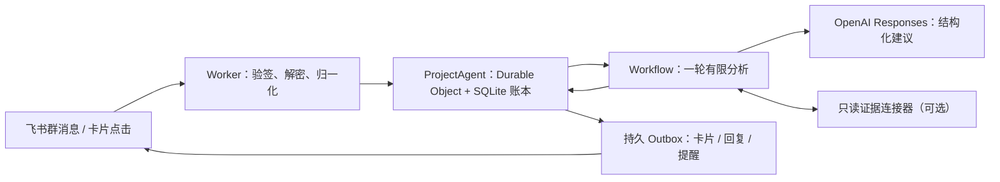

# Mysuperagent

**A coordination agent that lives in a Feishu (Lark) group.** It reads the team's messages, records every piece of feedback, turns real work into tasks, asks one owner to accept each task, and follows it through delivery and QA. Model output only ever _proposes_; every state change that belongs to a person (accepting, delivering, verifying) needs that person's click or command.

一个运行在飞书群里的研发协作 Agent：整理证据、拆解任务、交给对应负责人，并持续跟进到验收。模型只提建议；接手、交付、验收这些属于人的决定，必须由本人点卡片或发命令确认。

> 状态：可在本地完整运行和测试（mock 模式，126 项自动化测试）。还没有在真实飞书群里试点过，请先用 observe 模式接入测试群。

## 它在群里做什么

| 群里发生的事                       | Agent 的反应                                                                                 |
| ---------------------------------- | -------------------------------------------------------------------------------------------- |
| 有人报了一个问题、提了需求         | 拆成逐条事项保存；需要处理的事项登记为任务（`TASK-00001`），可多条共用一个任务但各自保留证据 |
| 原文明确了谁负责                   | 给这个人发**交接卡片**：确认接手 / 只是收到 / 不是我负责                                     |
| 负责人确认接手                     | 发**交付表单**，环境和版本按验收要求预填                                                     |
| 交付信息齐全                       | 自动转为“已修待测”，给验收人发**验收表单**；抽样通过不能替代全量验收                         |
| 验收标准还缺                       | 请验收人（或协调人）用表单补充，补完后负责人需重新确认范围                                   |
| 群里有人说“我来”“改好了”“验收通过” | 不直接改状态，只给本人发一张**一键确认卡**                                                   |
| 一直没人回应                       | 工作时间内提醒，带任务号和下一步做法；有冷却时间和每日上限                                   |
| 某条消息分析失败                   | 原文照常保存，并通知协调人，不会悄悄丢掉                                                     |

[`demo/`](demo/) 里有一段真实研发群（已脱敏）的逐条回放：左边是 466 条群消息，右边是 Agent 对每一条的反应（73 次发言、389 次沉默、4 次输出被校验拒绝）。

## 架构



- **账本**：任务、问题、案例、事件、待发消息分别按行存储在 Durable Object 的 SQLite 中，只写有变化的行；日志有上限，去重事件和已结束的分析按保留期清理。
- **分析**：每条消息启动一轮有限的 Workflow。输入按优先级裁剪到预算内（当前消息 → 同一问题的任务 → 最近活动），模型输出必须通过结构化校验和身份、修订、范围检查才会生效。
- **外发**：所有消息先写入 Outbox，带稳定的幂等键；发送结果不明时，只在飞书 `uuid` 去重窗口（1 小时）内自动重发，之后交人工核对。
- **模式**：`mock`（离线）→ `observe`（只读，不发消息）→ `pilot`（测试群）→ `active`。切换模式只能改配置，群消息无法改变权限。

更多见 [docs/architecture.md](docs/architecture.md)。

## 快速开始

需要 Node.js 24。

```bash
npx --yes pnpm@12.18.0 install --frozen-lockfile
npm run typecheck
npm test                 # 领域、合同、验收测试
npm run test:workers     # Cloudflare Workers 运行时测试（SQLite、重启、Workflow）
npm run dev              # 本地 mock 模式，http://127.0.0.1:8787
```

mock 模式完全离线：合成数据、确定性模型替身、假的消息通道。即使本机配置了真实密钥，也不会因此切换模式。

```bash
curl http://127.0.0.1:8787/health
curl -X POST http://127.0.0.1:8787/api/mock/events -H 'content-type: application/json' \
  -d '{"event_id":"e1","event_type":"feedback_observed","actor_key":"qa_lead","occurred_at":"2030-01-07T10:00:00+08:00","payload":{"case_id":"case-1","text":"转三圈只转了一圈"}}'
curl http://127.0.0.1:8787/api/state
```

## 接入飞书

1. 创建企业自建应用，开启机器人能力；按需开通权限：接收群消息（`im:message.group_at_msg:readonly`，或全部群消息权限）、以应用身份发消息（`im:message:send_as_bot`），读取截图时再加 `im:message:readonly`。
2. 事件订阅 `im.message.receive_v1`，卡片回调订阅 `card.action.trigger`，两者的请求地址都填 `https://<你的 Worker>/integrations/feishu/events`；配置 Encrypt Key 和 Verification Token。
3. 复制 `config/project.example.json`、`config/routing.example.json` 为本地 `*.local.json`，填入应用、群、成员的真实 ID（这些文件不会被提交），密钥写入 `.dev.vars` 或 Cloudflare secret。
4. 先用 `observe` 模式跑一段时间，再在测试群切到 `pilot`。

详细步骤见 [docs/feishu-setup.md](docs/feishu-setup.md)，群内命令见 [docs/commands.md](docs/commands.md)。

## 用你自己的群聊离线评估

`npm run replay:history` 把一份群聊导出逐条喂给 Agent，在本地记录它每一步会说什么、为什么沉默，生成和 `demo/` 一样的对照报告；不连接飞书，也不发任何消息。见 [docs/history-replay.md](docs/history-replay.md)。

## 已知限制

- 历史回放用的是回放专用的提示词和输出结构，线上 Workflow 用的是 `src/analysis/planner.ts` 中的另一套；线上提示词尚未用真实模型做过同等规模的评估。
- 模型接口目前只支持 OpenAI Responses（`MODEL_BASE_URL=https://api.openai.com/v1`）。
- 飞书项目（Project）作为任务后端的适配器未实现，默认使用内置账本。
- 视频、文件和合并转发消息的正文不读取；截图读取需显式开启。

## 许可证

[MIT](LICENSE)
