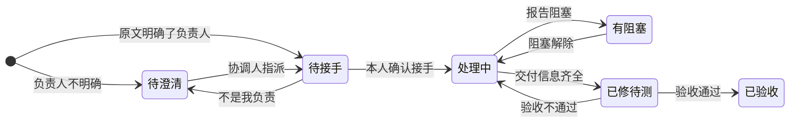
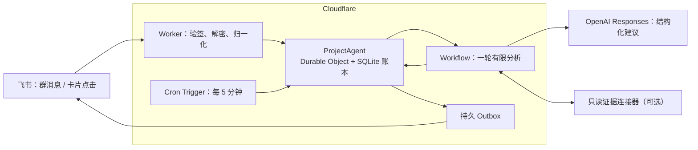

# Mysuperagent

**A coordination agent that lives in a Feishu (Lark) group.** It reads the team's messages, records every piece of feedback, turns real work into tasks, asks one owner to accept each task, and follows it through delivery and QA. Its design follows the domain model, principles and authorization model of DeepSeek's open-source [Super Agent prototype](https://github.com/deepseek-ai/dsh-superagent-prototype), and it runs on Cloudflare [Agents](https://developers.cloudflare.com/agents/) (Durable Objects) and [Workflows](https://developers.cloudflare.com/workflows/).

一个运行在飞书群里的研发协作 Agent：**整理证据、拆解依赖，把任务交给飞书里的对应负责人，并持续跟进到验收。** 模型只提建议；接手、交付、验收这些属于人的决定，必须由本人点卡片或发命令确认。

它的设计建立在两套公开实现之上：

- **架构来自 DeepSeek**：沿用 DeepSeek 开源的 Super Agent 原型的领域模型（来源 → 研判 → 工单 → 派工 → 订阅）、低打扰原则和“上下文不是授权”的授权模型，把执行端从编码会话换成飞书里的同事。
- **实现基于 Cloudflare**：Agents SDK 和 Durable Objects 让每个项目有一个常驻、按事件唤醒的主 Agent；Workflows 承载每一轮可恢复的分析；Workers 和 Cron 负责事件入口与定时跟进。

详见[设计基础](#设计基础)。

> 状态：可在本地完整运行和测试（mock 模式，126 项自动化测试）。还没有在真实飞书群里试点过，请先用 observe 模式接入测试群。

## 它在群里做什么

| 群里发生的事                       | Agent 的反应                                                                                 |
| ---------------------------------- | -------------------------------------------------------------------------------------------- |
| 有人报了一个问题、提了需求         | 拆成逐条事项保存；需要处理的事项登记为任务（`TASK-00001`），可多条共用一个任务但各自保留证据 |
| 原文明确了谁负责                   | 在群里 @ 这个人发**交接卡片**：确认接手 / 只是收到 / 不是我负责                              |
| 负责人确认接手                     | 发**交付表单**，环境和版本按验收要求预填                                                     |
| 交付信息齐全                       | 自动转为“已修待测”，给验收人发**验收表单**；抽样通过不能替代全量验收                         |
| 验收标准还缺                       | 请验收人（或协调人）用表单补充，补完后负责人需重新确认范围                                   |
| 群里有人说“我来”“改好了”“验收通过” | 不直接改状态，只 @ 本人发一张**一键确认卡**，本人点了才生效                                  |
| 一直没人回应                       | 工作时间内提醒，带任务号和下一步做法；有冷却时间和每日上限                                   |
| 某条消息分析失败                   | 原文照常保存，并通知协调人，不会悄悄丢掉                                                     |
| 只是普通讨论                       | 只记录，不发言                                                                               |

[`demo/`](demo/) 里有一段真实研发群（已脱敏）的逐条回放：左边是 466 条群消息，右边是 Agent 对每一条的反应（73 次发言、389 次沉默、4 次输出被校验拒绝）。

## 设计基础

Mysuperagent 的设计建立在两套公开实现上。**DeepSeek Super Agent 原型**决定它怎样工作：事件怎样变成工作，工作怎样交给执行者，后续消息怎样回到原来的工作，什么时候该说话，谁能授权。**Cloudflare 的 Agents、Durable Objects 和 Workflows** 决定它怎样持续运行：每个项目一个常驻的主 Agent，状态存在自带的 SQLite 里，事件到来时唤醒，每一轮分析都可以恢复和重试。

### DeepSeek Super Agent：领域模型、原则与授权

[DeepSeek Super Agent 原型](https://github.com/deepseek-ai/dsh-superagent-prototype)是 DeepSeek 开源的研究原型（MIT 许可）：一个运行在 DeepSeek Harness 里、面向单个 GitHub 仓库的主动式编码 Agent。它监听 GitHub（可选接入飞书），有权限的人提出请求时建立工单，在独立的会话里完成工作，再回到原对话汇报。

它的[领域文档](https://github.com/deepseek-ai/dsh-superagent-prototype/blob/main/docs/001-domain.md)把**来源、研判、工单、派工和执行端**拆开，并说明这些概念和规则可以复用，只有来源实现、策略内容、执行端和回复通道属于具体部署。Mysuperagent 沿用这套领域模型，替换了属于部署的部分：

| DeepSeek 原型                            | Mysuperagent                                                                               | 代码                                              |
| ---------------------------------------- | ------------------------------------------------------------------------------------------ | ------------------------------------------------- |
| **Source / Trigger**：事件来源与单个事件 | 飞书群消息、卡片点击、反馈与运行证据、定时检查，统一成带来源、线程、关联 ID 和可信度的事件 | `src/domain/contracts.ts`                         |
| **Eval · Gate**：确定性准入              | 群白名单、已核验成员、@ 范围和命令解析；不满足条件的事件直接忽略并返回原因，不进入研判     | `src/adapters/feishu.ts`                          |
| **Eval · Assessment**：模型研判          | 每条需要研判的消息一轮有限的分析：新事项、归入已有任务、补充证据、进展、阻塞，或者只是讨论 | `src/workflow.ts`、`src/analysis/`                |
| **Main Session**：主会话                 | 项目主 Agent：每个项目一个实例，维护账本、排队分析、派发外发消息                           | `src/coordinator.ts`                              |
| **Ticket**：一项被授权的工作             | 任务：有交付物、验收条件、修订号和下一步条件；上层还有问题和案例                           | `src/domain/contracts.ts`                         |
| **Assignment**：工单与执行端的绑定       | 指派：指派、收到、接手、结束分开记录，转交时保留原因                                       | `src/domain/contracts.ts`                         |
| **Subscription**：后续事件回到工单       | 回复原消息（或在同一话题里）的后续消息、提到任务号的消息，作为上下文回到对应任务           | `src/conversation.ts`                             |
| **Executor**：执行端                     | 飞书里的具体同事，通过交接卡、交付表单、验收表单和短命令处理任务                           | `src/domain/cards.ts`、`src/adapters/feishu-*.ts` |
| **Channel**：写回来源                    | 持久 Outbox → 项目群里的消息和卡片，@ 需要行动的人                                         | `src/adapters/feishu.ts`                          |
| **Attention**：等人决定的问题            | 关注列表：分析失败、发送结果不明等需要人核对的事项；分析失败会通知协调人                   | `src/coordinator.ts`                              |
| **Accept mode**：off / observe / auto    | 运行模式：mock / observe / pilot / active；和原型一样，先观察再逐步放开                    | `src/config.ts`                                   |

原型的[设计原则](https://github.com/deepseek-ai/dsh-superagent-prototype/blob/main/docs/000-philosophy.md)和[授权模型](https://github.com/deepseek-ai/dsh-superagent-prototype/blob/main/docs/002-authorization.md)，在这里变成了程序里的规则：

| DeepSeek 原型的原则                              | 在 Mysuperagent 中                                                                             |
| ------------------------------------------------ | ---------------------------------------------------------------------------------------------- |
| 尽量少占用人的注意力，尽量多提供价值             | 正常推进时不说话；提醒只在工作时间发，有冷却时间和每日上限；分析失败每小时最多通知一次         |
| 只在被请求、或有书面规则允许时行动               | 只有原文明确指定了负责人（能逐字引用）才直接派单；拿不准时交给协调人，不猜                     |
| 只在有人需要行动、或能用上结果时说话             | 每条外发都指向一个要行动的人：交接、交付、验收、补验收标准、到期提醒                           |
| 一次只问一个具体问题                             | 缺验收标准时，给验收人（或协调人）发一张表单，而不是在群里连续追问                             |
| 如实汇报                                         | 分析失败、发送结果不明都不会被静默丢弃：原文保留，进入关注列表                                 |
| 允许名单、规则和授权由宿主执行                   | 模式、群白名单、成员身份和能力开关只来自配置文件和 secret                                      |
| 消息、评论和引用文档只是决策的输入，不能改变权限 | 群消息、日志和证据都按不可信上下文处理；群里说“我来”“改好了”只触发一张确认卡，本人点了状态才变 |

原型的执行端是编码会话，Mysuperagent 的执行端是人，所以补充了原型里没有的协作规则：

- 每个任务只有一位主负责人，另有协作者和验收人。
- “收到”不等于接手，接手不等于承诺了日期；建议时间和本人承诺的时间分开记录。
- 验收写明预期、原用例、环境、版本和范围；抽样通过不能替代全量验收，问题的验收和任务的验收分开。
- 范围变化后，负责人要重新确认接手；旧的分析结果不能覆盖人的新决定。

### Cloudflare：持久运行的具体实现

DeepSeek 原型作为本地进程运行在 DeepSeek Harness 里，状态存在一个 SQLite 文件中。研发协作的任务往往要等上几天，所以 Mysuperagent 把同一套模型放到 Cloudflare 上运行：不需要一台常开的机器，等待期间也不占用计算资源。

| Cloudflare 组件              | 在 Mysuperagent 中的作用                                                                                  | 代码                                   |
| ---------------------------- | --------------------------------------------------------------------------------------------------------- | -------------------------------------- |
| Workers                      | 事件入口：飞书验签解密、事件与卡片回调分流（卡片 3 秒内返回 toast）、管理接口鉴权                         | `src/worker.ts`                        |
| Agents SDK + Durable Objects | 项目主 Agent `ProjectAgent`：每个项目一个实例，账本按行存在实例自带的 SQLite 里；有事件时唤醒，空闲时休眠 | `src/coordinator.ts`、`src/storage.ts` |
| Workflows                    | 每条消息一轮可恢复的分析 `IssueRound`：读取上下文 → 有时限地等待证据 → 调用模型 → 提交前核对修订号        | `src/workflow.ts`                      |
| Cron Triggers                | 每 5 分钟检查到期的跟进条件和待发消息                                                                     | `wrangler.jsonc`                       |

选择这套组合，是因为 Cloudflare 文档描述的特性正好对应协作 Agent 的需要：

- Agent [以持久状态存在、可寻址，休眠时不消耗计算](https://developers.cloudflare.com/agents/concepts/agentic-patterns/long-running-agents/)，适合一等就是几天的人工任务。
- Durable Object [有全局唯一的名字和强一致的事务存储，单线程执行](https://developers.cloudflare.com/durable-objects/concepts/what-are-durable-objects/)，同一项目的事件按顺序写进同一本账。
- Workflow 把[每次模型调用和工具调用都做成可单独重试的一步](https://developers.cloudflare.com/workflows/get-started/durable-agents/)，一轮分析中途失败可以恢复。

Cloudflare 也写明了这套运行时的边界，每一条都有对应的设计：

| 运行时的边界                                                                                                                                       | 对应的设计                                                                                                |
| -------------------------------------------------------------------------------------------------------------------------------------------------- | --------------------------------------------------------------------------------------------------------- |
| Workflow 步骤可能被重试，[应尽量幂等](https://developers.cloudflare.com/workflows/build/rules-of-workflows/)；外部调用可能失败重试，但对方已经执行 | 所有外发先写入 Outbox，带稳定的操作 ID 和飞书 `uuid`；结果不明时只在 1 小时去重窗口内重发，之后交人工核对 |
| Workflow 可能休眠并丢失内存状态                                                                                                                    | 事件和待分析的运行在同一次写入里落进账本，之后才启动 Workflow；每一步都从账本读取上下文                   |
| Durable Object 是协作式多任务，跨外部调用的先后顺序要自己保证                                                                                      | 分析结果提交时核对任务修订号；期间任务有更新，就丢弃旧结果重新分析（最多两次）                            |
| Durable Object 的 SQLite 单行有大小上限                                                                                                            | 账本按行存储、只写变化的行；日志有上限，过期记录按保留期清理                                              |
| 飞书会重推没有及时确认的事件                                                                                                                       | 按来源事件 ID 去重；不属于本项目的事件也返回 200，机器人自己的消息直接忽略                                |
| 网络错误和业务拒绝性质不同                                                                                                                         | 可重试的错误按计时重试；业务拒绝写入审计，并把原因告诉操作的人                                            |

## 工作方式

### 案例、问题、任务

对使用者只暴露三个概念：

- **案例**：一次真实发生的现象，包括原始消息或反馈、当时的上下文、日志、版本和环境，以及为什么不符合预期。
- **问题**：需要解决的一类偏差，可以关联多个案例。多条反馈可以归到同一个任务，但每条都保留自己的案例和证据，避免错误合并后丢掉独立的问题。
- **任务**：交给一个人的具体交付，分诊断、实现、验证、决定四类。诊断任务交付结论就可以完成，对应的问题仍可能需要修复和验收。

任务状态：



未结束的任务都可以暂缓或取消；已验收的任务出现回归时可以重新打开。

### 一轮处理

每条需要研判的消息触发一轮有限的处理，并以明确的结果结束：

1. **接收**：验签、去重，原文先写入账本。
2. **研判**：读取相关任务、同一问题下的记录和最近的讨论，按预算裁剪后交给模型；当前消息总是完整保留。
3. **校验**：模型的建议要通过结构化校验，以及身份（只能选已核验成员）、修订（任务有更新就重新分析）和范围检查。
4. **落地**：登记事项和任务、补充证据、发出交接卡，或者什么都不做。普通讨论只记录，不发言。
5. **等待**：每个活跃任务保存一个“下一步条件”：等接手、等依赖、等验收、等决定，或者到某个时间再检查。条件满足或到期时才进入下一轮。

“持续跟进”靠的是这些保存下来的等待条件，模型不需要一直运行。

### 派给谁

1. **已有指派**：后续消息更新原任务，不重新派单。
2. **原文明确指定**：例如“@某人 你看一下”“这个我来”，模型必须逐字引用这句原文。
3. **职责路由表**：`config/routing.local.json` 按模块列出负责人和验收人，供模型参考。
4. **以上都不明确**：任务停在“待澄清”，交给协调人，不猜。

无论哪种情况，负责人都只能是已核验的成员。被指派的人可以点“不是我负责”退回，协调人会收到重新指派的提示。

### 什么时候提醒

- 只在工作日的工作时间内提醒，有冷却时间（默认 120 分钟）和每日上限，都可以在配置里改；提醒策略确认之前不会真正发出。
- 提醒带任务号、标题和下一步做法，并附上与状态对应的卡片：待接手发交接卡，处理中发交付表单，已修待测发验收表单。
- 等待依赖的任务，提醒里写明在等什么，以及依赖解除后怎样告诉 Agent。

## 架构



| 模式    | 行为                                                   |
| ------- | ------------------------------------------------------ |
| mock    | 全离线：合成数据、确定性模型替身、假消息通道           |
| observe | 真实只读接入：记录到内部账本，不发消息、不写外部工作项 |
| pilot   | 仅测试环境、白名单群和已核验成员，有限写入             |
| active  | 正式范围内运行，同样受上述检查约束                     |

切换模式只能改配置，群消息无法改变权限。更多见 [docs/architecture.md](docs/architecture.md)。

## 快速开始

需要 Node.js 24。

```bash
npx --yes pnpm@12.18.0 install --frozen-lockfile
npm run typecheck
npm test                 # 领域、合同、验收测试
npm run test:workers     # Cloudflare Workers 运行时测试（SQLite、重启、Workflow）
npm run dev              # 本地 mock 模式，http://127.0.0.1:8787
```

mock 模式完全离线：合成数据、确定性模型替身、假的消息通道。即使本机配置了真实密钥，也不会因此切换模式。

```bash
curl http://127.0.0.1:8787/health
curl -X POST http://127.0.0.1:8787/api/mock/events -H 'content-type: application/json' \
  -d '{"event_id":"e1","event_type":"feedback_observed","actor_key":"qa_lead","occurred_at":"2030-01-07T10:00:00+08:00","payload":{"case_id":"case-1","text":"转三圈只转了一圈"}}'
curl http://127.0.0.1:8787/api/state
```

## 接入飞书

1. 创建企业自建应用，开启机器人能力；按需开通权限：接收群消息（`im:message.group_at_msg:readonly`，或全部群消息权限）、以应用身份发消息（`im:message:send_as_bot`），读取截图时再加 `im:message:readonly`。
2. 事件订阅 `im.message.receive_v1`，卡片回调订阅 `card.action.trigger`，两者的请求地址都填 `https://<你的 Worker>/integrations/feishu/events`；配置 Encrypt Key 和 Verification Token。
3. 复制 `config/project.example.json`、`config/routing.example.json` 为本地 `*.local.json`，填入应用、群、成员的真实 ID（这些文件不会被提交），密钥写入 `.dev.vars` 或 Cloudflare secret。
4. 先用 `observe` 模式跑一段时间，再在测试群切到 `pilot`。

详细步骤见 [docs/feishu-setup.md](docs/feishu-setup.md)，群内命令见 [docs/commands.md](docs/commands.md)。

建议按这个顺序试点：

1. 用历史群聊离线回放，看它会怎样归并、拆解和派单，据此修正职责路由表。
2. 用 observe 模式接入测试群，只记录、不发言，检查它的判断。
3. 切到 pilot，从证据具体、责任明确的问题开始，跑通交接、交付和验收。
4. 再加入跨模块、有依赖的问题，检查牵头、协作和阻塞的处理。

## 用你自己的群聊离线评估

`npm run replay:history` 把一份群聊导出逐条喂给 Agent，在本地记录它每一步会说什么、为什么沉默，生成和 `demo/` 一样的对照报告；不连接飞书，也不发任何消息。见 [docs/history-replay.md](docs/history-replay.md)。

回放和试点时可以按这些维度检查：

| 维度       | 应达到的结果                             |
| ---------- | ---------------------------------------- |
| 证据完整   | 负责人能找到原消息、上下文和必要的日志   |
| 派单准确   | 初始负责人合理，调整有记录               |
| 任务可执行 | 交付物和验收条件足够明确                 |
| 不重复     | 同一事件不会重复建任务，相似反馈保留关联 |
| 状态准确   | 已修、抽样通过和验收通过分别记录         |
| 低打扰     | 提醒指向具体行动，正常推进时不说话       |

## 路线图

V1 设计中还没有实现的部分：

- **正式工作项同步**：与飞书项目等系统双向同步负责人、日期和状态。目前任务只存在内置账本里，领域层已预留外部记录字段和工作项事件来源。
- **训练、构建、部署事件**：领域层已能处理依赖和部署事件，还缺对接真实系统的适配器。
- **升级规则**：长时间无响应时，按团队约定从负责人升级到协调人。
- **项目视图**：按待接手、处理中、有阻塞、已修待测、需要决定分组展示；目前只有 `/api/state` 返回的 JSON。
- **按需扩展**：用 R2 保存证据快照，用 Queues 应对入口突发流量。
- **更多渠道**：企业微信、邮件等复用同一套问题、任务、派工和订阅模型；身份按渠道分别核验，不凭同名自动认定为同一个人。

## 已知限制

- 历史回放用的是回放专用的提示词和输出结构，线上 Workflow 用的是 `src/analysis/planner.ts` 中的另一套；线上提示词尚未用真实模型做过同等规模的评估。
- 模型接口目前只支持 OpenAI Responses（`MODEL_BASE_URL=https://api.openai.com/v1`）。
- 飞书项目（Project）作为任务后端的适配器未实现，默认使用内置账本。
- 视频、文件和合并转发消息的正文不读取；截图读取需显式开启。

## 参考

- DeepSeek Super Agent 原型：[仓库](https://github.com/deepseek-ai/dsh-superagent-prototype)、[000 Philosophy](https://github.com/deepseek-ai/dsh-superagent-prototype/blob/main/docs/000-philosophy.md)、[001 Domain](https://github.com/deepseek-ai/dsh-superagent-prototype/blob/main/docs/001-domain.md)、[002 Authorization](https://github.com/deepseek-ai/dsh-superagent-prototype/blob/main/docs/002-authorization.md)
- Cloudflare：[Long-running agents](https://developers.cloudflare.com/agents/concepts/agentic-patterns/long-running-agents/)、[What are Durable Objects?](https://developers.cloudflare.com/durable-objects/concepts/what-are-durable-objects/)、[Build a Durable AI Agent](https://developers.cloudflare.com/workflows/get-started/durable-agents/)、[Rules of Workflows](https://developers.cloudflare.com/workflows/build/rules-of-workflows/)

Mysuperagent 是独立项目，与 DeepSeek、Cloudflare 都没有隶属关系；它参考的是上述公开设计文档，不是 DeepSeek 原型的分支。

## 许可证

[MIT](LICENSE)
